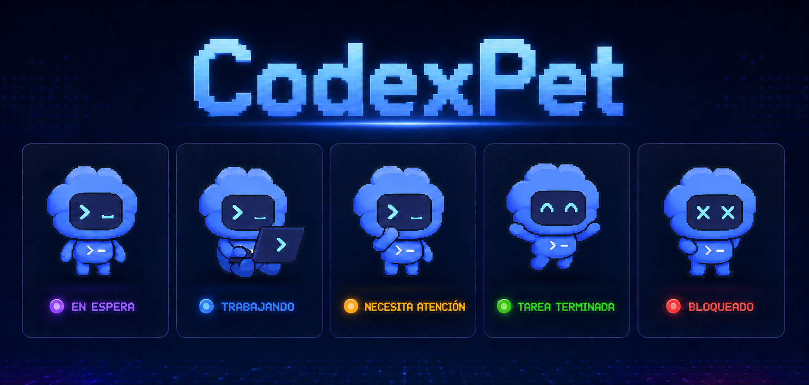

# CodexPet

[Documentación en español](README.es.md)

A native Windows desktop pet written in Rust. It follows local Codex activity in a transparent, always-on-top window.

> The official mascots and visual assets belong to OpenAI/Codex and their respective owners. CodexPet is an independent, unofficial project.

## Features

- Eight pets and six states: idle, working, needs attention, complete, failed and offline.
- English and Spanish, saved pet selection, size and position.
- Native Win32 graphics and background monitoring in a single process.
- A mascot application icon embedded in the executable and installer, with sizes for Windows display scaling.
- **Minimize to tray** from the context menu; click the tray icon or choose **Show pet** to restore it. Monitoring continues while hidden.
- Multiple-session state aggregation and tool-call correlation for questions and approvals.
- Per-user installation, Windows startup and manual update checks.

## Install and use

Requires Windows 10 version 1703 or later, or Windows 11, x64. Live states require `codex.exe` and its local session logs.

Run `CodexPet-Setup.exe` to install for the current user, or open `CodexPet.exe` from the portable ZIP. All pets and icons are embedded: the executable works on its own. Installation, upgrades, shortcuts and removal are implemented in Rust. Existing preferences in `%APPDATA%\CodexPet` are preserved.

- Drag the card to move it, or a corner to resize it.
- Right-click for pet, language, tray, startup, updates and close actions.
- Double-click the card to open Windows Terminal with Codex.
- Closing the pet ends its observer too.

| Command | Purpose |
| --- | --- |
| `CodexPet.exe` | Show the pet, including when Codex is offline. |
| `CodexPet.exe --watch` | Show automatically while Codex runs; otherwise stay in the background. |
| `CodexPet.exe --stop` | Close the native instance normally. |
| `CodexPet.exe --install` | Install or upgrade under `%LOCALAPPDATA%\CodexPet`. |
| `CodexPet.exe --uninstall` | Remove the per-user installation; keep preferences. |

Manual tray minimization remains in effect until the user restores the pet. The tray menu also offers **Close pet**. Windows may place its icon in the notification area's overflow menu.

## Privacy

CodexPet reads local JSONL sessions and read-only approval metadata under `$CODEX_HOME`, defaulting to `%USERPROFILE%\.codex`. Records stay on the device. Only a user-requested update check contacts GitHub; downloads are never installed automatically. Codex's internal log formats can change; see [architecture and detection limitations](docs/ARCHITECTURE.md).

## Development and file placement

Build and verify with `cargo xtask release`; run source checks with `cargo xtask check`. Rust MSVC, C++ Build Tools and Windows SDK are the build prerequisites. This repository follows common Cargo project conventions. See [development and packaging](docs/DEVELOPMENT.md) and the [architecture](docs/ARCHITECTURE.md).

| New file | Place it here |
| --- | --- |
| Rust business logic | `src/`, grouped by responsibility. |
| Windows-specific code | `src/platform/`, inside the relevant module. |
| Unit tests | Beside the module in `#[cfg(test)]`; add `tests/` only when actual integration tests are needed. |
| Pet frames embedded at build time | `assets/pets/<pet>/frame_000.png` through `frame_071.png`. |
| Embedded application icon | `assets/icons/codexpet.ico`; `build.rs` embeds it during compilation. |
| Technical documentation or screenshots | `docs/` or `docs/images/`. |
| Cargo build, packaging and native checks | `xtask/src/`. |
| Installation and removal | `src/platform/install.rs`. |

`Cargo.toml` controls the version. `Cargo.lock` is tracked for reproducible dependency resolution. `.build/`, `target/` and `dist/` contain local tools or generated files and are excluded from Git. Secrets and machine-specific configuration do not belong in source control.

See [CHANGELOG.md](CHANGELOG.md) for changes.
